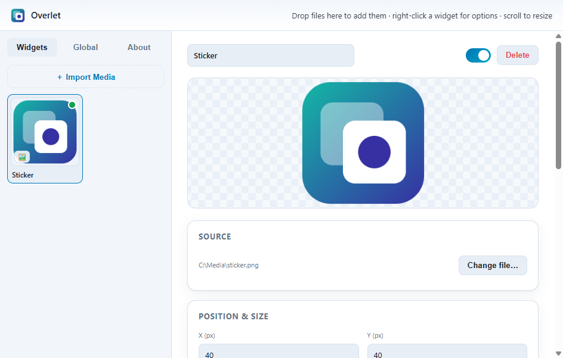
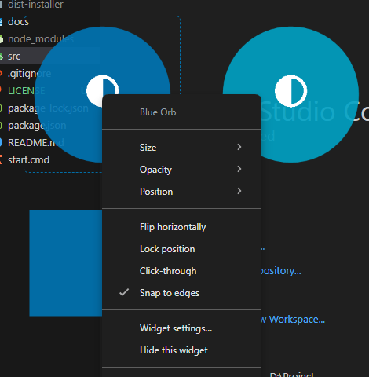

# Overlet

Put anything visual on top of your desktop: a small GIF in a corner, a banner across the bottom of the screen, or a full-screen animated layer. Overlet stays above the taskbar and borderless games.

Windows 10 and 11. Free and open source under the [MIT License](LICENSE).



## Important notes

- **No warranty.** The app is provided as is, and things can change between versions.
- **The downloads are not code signed.** Windows SmartScreen or your antivirus may warn you. Download only from this repository.
- **Nothing is collected.** The app has no telemetry, accounts or ads, and it makes no network requests of its own. See [PRIVACY.md](PRIVACY.md).
- **Use media you have the right to use.** The app shows your own local files. It does not include or download any.

## Features

- Show GIF, APNG, PNG, JPG, WebP, AVIF, SVG, BMP, ICO and WebM files, with support for transparency.
- Run many widgets at once, each in its own window. Add files by dropping them on the manager, from the tray menu, or with **Import Media**.
- Place a widget across the bottom, top, left or right of the screen, fill the screen, or pin it to a corner. It stays in place when the display changes.
- Drag a widget to move it, scroll to resize it, and right-click it for options.
- Set position, size, opacity, rotation, fit, flip, loop, mute and volume per widget.
- Lock a widget's position, or make it click-through so the mouse reaches the app behind it.
- Snap widgets to monitor edges and move them between monitors.
- Set global hotkeys, start with Windows, and run from the system tray.

## Install

### Installer

1. Download `Overlet-Setup-<version>.exe` from [Releases](https://github.com/kwhyu/overlet/releases/latest).
2. Open it. If SmartScreen appears, select **More info**, then **Run anyway**, only if you downloaded it from this repository.
3. Finish the wizard and open the app from the Start menu or the desktop shortcut.

### From source

Requires the LTS version of [Node.js](https://nodejs.org/).

```powershell
git clone https://github.com/kwhyu/overlet.git
cd overlet
npm install
npm start
```

To build the installer in `dist-installer\`, run `npm run dist`.

### Uninstall

Use **Settings > Apps > Installed apps**. This keeps your settings. To delete them too, delete `%APPDATA%\overlet`.

## Usage

1. Open the manager from the tray icon or with `Ctrl+Alt+S`, then drop your files on it or select **Import Media**.
2. Use the widget directly on your desktop:

   | Action | Result |
   | --- | --- |
   | Left-drag | Move, snapping to monitor edges |
   | Scroll | Resize, keeping the proportions. On a full-width or full-height widget, change its thickness |
   | Right-click | Size, opacity, placement, flip, lock, click-through and more |

3. For a banner across the screen, right-click the widget and select **Position > Bottom, full width**. Use **Fit** in the manager to choose between showing the whole file and cropping it to fill the strip. Dragging the widget returns it to a free position.
4. Before you play a game or work behind a widget, select **Make all click-through** in the tray menu or press `Ctrl+Alt+L`.

| Screenshot | Shows |
| --- | --- |
|  | The menu you get when you right-click a widget |

### Default hotkeys

| Action | Hotkey |
| --- | --- |
| Toggle click-through for all widgets | `Ctrl+Alt+L` |
| Show or hide all widgets | `Ctrl+Alt+H` |
| Open the manager | `Ctrl+Alt+S` |

Change them in the **Global** tab.

## Limitations

- A game in exclusive fullscreen can cover the overlay. Set the game to borderless or windowed.
- A click-through widget cannot be dragged or right-clicked. To get control back, select **Make all widgets interactive** in the tray menu or press `Ctrl+Alt+L`.
- Only Windows is tested.
- MP4, MOV and other H.264, H.265 or AAC files are not supported, because the app does not include those patented decoders. Convert them to WebM. Some of these videos may still open through **All Files** if your PC has a hardware decoder for them, but this is not guaranteed.

## Project structure

The app uses Electron with plain HTML, CSS and JavaScript, and has no build step for the interface.

```text
src/
  assets/      App and tray icon
  main/        Main process: startup, tray, hotkeys, menus, windows and settings
  preload/     Bridges between the windows and the main process
  renderer/
    overlay/   Transparent widget window
    settings/  Manager window
    shared/    Code used by both windows
```

## Contributing

Contributions are welcome. Read [CONTRIBUTING.md](CONTRIBUTING.md) first. Report security problems privately as described in [SECURITY.md](SECURITY.md), not in a public issue.

## License and legal

Overlet is released under the [MIT License](LICENSE). You may use, change and share it, including commercially, as long as you keep the copyright and license notice.

| Document | Covers |
| --- | --- |
| [PRIVACY.md](PRIVACY.md) | No data collection, and what stays on your device |
| [SECURITY.md](SECURITY.md) | Reporting vulnerabilities and verifying downloads |
| [THIRD-PARTY-NOTICES.md](THIRD-PARTY-NOTICES.md) | Open source components |
| [CHANGELOG.md](CHANGELOG.md) | Changes in each version |

### Trademarks and your media

Windows and other names belong to their owners. They are used here only for identification or description.

The MIT License covers this project's code. It does not give you rights to images, GIFs or videos you load into the app. You are responsible for having the rights to use them.
